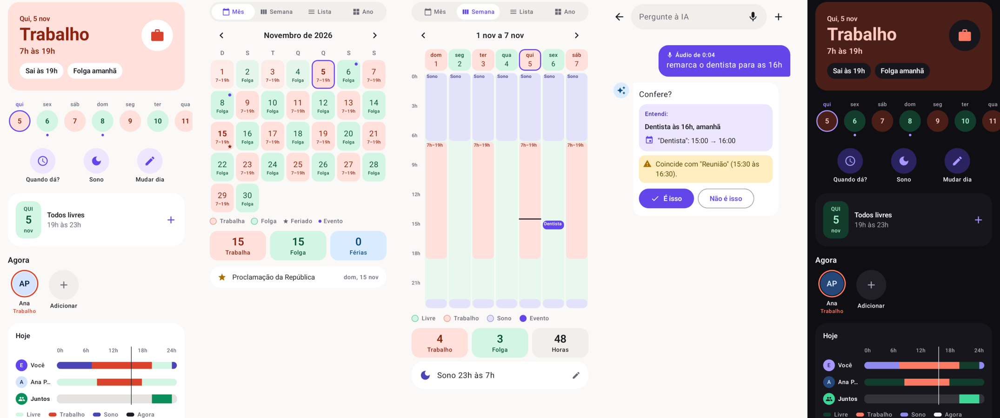

# Folgui

**A agenda de quem trabalha em escala.** O Folgui mostra de um jeito simples quais dias são de trabalho e de folga, ajuda a marcar compromissos sem cair no trabalho nem no sono e encontra as folgas em comum com a família e os amigos.



[Veja o app funcionando (vídeo de 56 s)](docs/demo.mp4)

Android 7.0 ou mais novo. Versão de relógio para Wear OS 3 ou mais novo.

## Como é usar

Cole uma lista na conversa com a IA, do jeito que ela chegou para você:

> 24/11/2026 às 16:12, Dra. Ana Souza (psicóloga)
>
> 28/11/2026 às 12:00, Dr. Bruno Lima (dentista)
>
> 05/01/2027 às 08:00, Carla Reis (educadora física)

A conversa continua assim:

> **Folgui:** Encontrei 3 compromissos! Quer que eu organize todos no grupo Consultas?
>
> **Você:** Sim!
>
> **Folgui:** Perfeito! O grupo Consultas já existe e usa a cor vermelha. Quer manter essa cor? E quer receber notificações antes dos compromissos?
>
> **Você:** Sim, me avise 1 dia antes e 1 hora antes.

Antes de criar, o app mostra uma prévia. Nela dá para editar ou tirar cada item, e ela aponta o que cai no trabalho, no sono ou por cima de outro evento. Depois da confirmação, os eventos vão para a Google Agenda já com a cor do grupo e os avisos.

## O que ele faz

### Escala e agenda

- **Escalas:** semanal, 12x36, 24x48, 2x2, 4x2, 5x1, 6x1 ou um ciclo personalizado, com férias, trocas de plantão e folgas extras.
- **Agenda em quatro visões:** mês (com o turno em cada dia), semana (hora a hora), lista e ano.
- **Horário de sono:** a sugestão acompanha o horário de trabalho (quem entra às 6h não acorda às 7h). Nada é sugerido nesse trecho, e marcar algo ali pede confirmação.
- **Segundo emprego ou faculdade:** cada atividade tem nome e escala própria e conta nos horários ocupados.
- **Início que muda com a semana:** atalhos ilustrados mostram a próxima folga, o dia em que todos estão livres, o trabalho de amanhã e o próximo feriado. Só quem folga em feriados vê a pergunta, e só na semana anterior à data.

### Compromissos e grupos

- **Compromissos:** o fim é opcional. Criar, editar, remarcar com sugestões de horários livres e excluir, com até 5 avisos.
- **Grupos de eventos:** pastas com nome e cor, como "Consultas". Os eventos herdam a cor do grupo na Google Agenda; evento sem grupo fica com a cor padrão. Dá para criar, mover, ver próximos e anteriores, trocar a cor de todos de uma vez e excluir o grupo mantendo ou não os eventos.
- **Google Agenda nos dois sentidos:** o que é marcado no Folgui vai para a agenda com cor e avisos. O que muda direto nela volta para o app ao abri-lo, ao voltar para ele ou ao trocar de tela. Evento apagado lá fica marcado no Folgui, com as opções de restaurar ou excluir. Os criados na Google Agenda aparecem no app e abrem nela para edição.

### Assistente com IA

- **Pedidos do dia a dia:** fica na barra do topo e aceita texto ou áudio, que aparece transcrito na conversa. Mostra o que entendeu, confere o pedido contra a escala e só altera algo depois da confirmação.
- **Vários compromissos de uma vez:** lê datas, horários e nomes, pergunta só o que faltou (grupo, cor, avisos) e reconhece o que já está na agenda, para não duplicar. Se um item falhar, a nova tentativa refaz só os pendentes.
- **Respostas curtas:** entende "sim", "não", "muda para azul" e "só nos três primeiros". Quem já diz tudo no pedido não recebe perguntas.

### Pessoas e conta

- **Amigos com Folgui:** cada pessoa tem um código para enviar a um amigo. Conectados, os dois veem a escala um do outro, atualizada sozinha, e podem mandar compromissos como convite. Sono, eventos e nomes de atividades não são compartilhados. Quem não tem o app continua podendo ser cadastrado à mão.
- **Conta (Google ou e-mail):** o login vem antes do cadastro e guarda escala, atividades, pessoas, eventos e grupos na conta. Tudo volta ao entrar em outro celular.
- **Apresentação e modo fácil:** quem abre o app pela primeira vez vê um passo a passo, que pode ser revisto no perfil. O modo fácil aumenta os textos do app inteiro.

## Como rodar

1. Copie `.env.example` para `.env` e preencha a chave da [API do Gemini](https://aistudio.google.com/apikey).
2. Abra o projeto no Android Studio, ou rode:

   ```
   ./gradlew :app:assembleDebug
   ```

O `GEMINI_MODEL` é o modelo principal. Se ele estiver lotado ou sem cota, o app usa outros modelos automaticamente.

**Login (opcional):** crie um projeto no Firebase com Authentication (Google e e-mail) e Firestore, publique as regras com `firebase deploy --only firestore` e coloque o `google-services.json` em `app/`. Sem esse arquivo, o app abre sem pedir login.

## Tecnologias

| Parte | O que usa |
| --- | --- |
| App | Kotlin e Jetpack Compose, sem layouts XML, com Navigation Compose |
| Dados no aparelho | DataStore e SQLite |
| Conta e nuvem | Firebase Authentication e Firestore |
| Agenda | Provedor de calendário do Android (`CalendarContract`), com a conta Google do aparelho |
| IA | API REST do Gemini, com resposta em JSON estruturado |
| Feriados | BrasilAPI |
| Relógio | Wear OS, ligado ao celular pelo Wearable Data Layer |

## Como o código está organizado

Todos os arquivos ficam em `app/src/main/java/com/example/folgui`. Para quem está começando, esta é uma boa ordem de leitura:

| Assunto | Arquivos |
| --- | --- |
| Início do app | `MainActivity.kt` abre o `FolguiApp.kt`, que guarda os dados da sessão e liga as telas às ações |
| Navegação | `Navegacao.kt`: rotas e barra de abas |
| Regras da escala | `Escala.kt` e `Datas.kt`: não dependem de tela e têm testes |
| Dados no aparelho | `Preferencias.kt` (DataStore), `BancoHelper.kt` e `FolguiRepository.kt` (SQLite) |
| Serviços externos | `ApiRepository.kt` (REST), `AgendaRepository.kt`, `NuvemRepository.kt`, `AmigosRepository.kt` e `AssistenteIA.kt` |
| Grupos e listas | `Grupos.kt` (cores e conciliação), `Lote.kt` (plano da lista, sem tela) e `ServicoAgenda.kt` (app e agenda sempre juntos) |
| Lembretes | `AlarmScheduler.kt`, `ReminderReceiver.kt`, `NotificationHelper.kt` e `BootReceiver.kt` |
| Telas | Arquivos `Telas*.kt` e `EtapasEscala.kt` |
| Aparência | `Tema.kt` e `Componentes.kt` |

A IA nunca altera dados sozinha: ela só propõe ações e ajustes, e é o app que confere conflitos e repetidos e aplica o que a pessoa confirmou.

## Testes

| Comando | O que testa |
| --- | --- |
| `./gradlew :app:testDebugUnitTest` | Regras da escala, leitura da resposta da IA, listas, grupos e conciliação |
| `./gradlew :app:connectedDebugAndroidTest` | Agenda e banco de verdade, em um aparelho ou emulador. **Apaga os dados do app no aparelho** |
| `FOLGUI_IA=1 ./gradlew :app:testDebugUnitTest --tests '*LoteGeminiTest' --rerun` | Conversa real com o Gemini. Gasta a cota diária da chave |

## Versão de relógio

O módulo `wear` é um app para Wear OS (Galaxy Watch, Pixel Watch). Não funciona no Apple Watch.

1. A pessoa toca no microfone e fala: "marque almoço com a Bia amanhã às 13h".
2. O relógio transforma a fala em texto e manda para o celular pelo Bluetooth.
3. No celular, o `RelogioService` chama a mesma IA do assistente e confere conflitos com trabalho e sono.
4. O relógio mostra e fala o resumo e pergunta "É isso mesmo?".
5. Com o "Sim", o celular salva o evento, agenda o lembrete, grava na Google Agenda, se ela estiver conectada, e manda o convite aos amigos conectados que participam.

Escala, eventos e chave do Gemini ficam só no celular. Pelo relógio dá para marcar um compromisso por vez; listas e o resto se fazem no celular. Os dois apps precisam ter o mesmo `applicationId` e a mesma assinatura para conversar.

## Limites da Google Agenda

- A agenda não tem pastas, então os grupos ficam no Folgui, ligados aos eventos. Quem vê a agenda em outro lugar enxerga só a cor.
- São 11 cores por evento, as mesmas da paleta de grupos. Contas que não são do Google não têm essas cores, e os eventos ficam sem cor de grupo.
- Cada evento aceita até 5 avisos, com no máximo 4 semanas de antecedência.
- Quando os avisos vão para a agenda, a notificação vem da Google Agenda, e o alarme do Folgui é cancelado para não avisar duas vezes.
- Eventos recorrentes, de dia inteiro ou somente leitura não entram em grupos.

## Sobre a chave da API

O `.env` e os APKs ficam fora do Git, porque a chave vai embutida no APK e pode ser extraída dele. Para distribuir o app a outras pessoas, o certo é colocar as chamadas ao Gemini atrás de um servidor próprio.

## Design

Cada cor tem um só significado, e as telas usam ícones e rótulos curtos. As regras estão em [docs/DESIGN.md](docs/DESIGN.md).

## Requisitos da atividade

| Requisito | Onde está |
| --- | --- |
| Kotlin e Jetpack Compose | Todo o app, sem layouts XML |
| Navegação entre telas | `NavHost` e `NavController` em [FolguiApp.kt](app/src/main/java/com/example/folgui/FolguiApp.kt) |
| DataStore | Perfil, escala e preferências em [FolguiApp.kt](app/src/main/java/com/example/folgui/FolguiApp.kt) |
| SQLite | [BancoHelper.kt](app/src/main/java/com/example/folgui/BancoHelper.kt) e [FolguiRepository.kt](app/src/main/java/com/example/folgui/FolguiRepository.kt) |
| API REST | BrasilAPI (feriados) em [ApiRepository.kt](app/src/main/java/com/example/folgui/ApiRepository.kt) |
| Notificações locais | [AlarmScheduler.kt](app/src/main/java/com/example/folgui/AlarmScheduler.kt), [ReminderReceiver.kt](app/src/main/java/com/example/folgui/ReminderReceiver.kt) e [NotificationHelper.kt](app/src/main/java/com/example/folgui/NotificationHelper.kt) |

## Créditos

O vídeo foi gravado com dados fictícios. Música: Uplifting Corporate, de Soundrider/Dope (CC BY 3.0).
